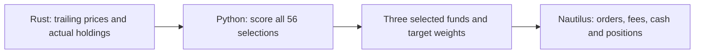

# Quantum Finance Lab

A small **Rust backtest using NautilusTrader**, a separate **Python research worker**, and a **quantum lab on CUDA-Q** that compares classical and quantum methods and reports the results in one tearsheet.

Python downloads and prepares data; Rust runs the trading simulation. Nautilus maintains the actual orders, fills, cash, and holdings. Usage and explanations live in this README; internal notes and lessons remain ignored.

## Find your way around the code

A Rust module is a labeled drawer: related code lives together, and other modules use its public functions. `mod.rs` is the entry point for a folder. `lib.rs` declares the available modules; `main.rs` chooses which command to run.

```text
src/
├── main.rs               Command-line entry point
├── lib.rs                Library module declarations
├── config.rs             Portfolio and optimizer settings, shared validation
├── backtest/
│   ├── mod.rs            Run a portfolio simulation and save its results
│   ├── engine.rs         Configure the native Nautilus account and instruments
│   ├── strategy.rs       React to bars, plan allocations, and execute orders
│   ├── state.rs          Account snapshots, decisions, and fill records
│   └── comparison.rs     Compare a strategy with its baseline
├── data/
│   ├── mod.rs            Validate snapshots and build synchronized trading bars
│   └── historical.rs     Read historical CSV/Parquet and the frozen calendar
├── research.rs           Send past-only requests to Python; validate and replay answers
├── output.rs             Save reports, file hashes, and run provenance
└── demo/                 Original single-fund example and saved-instruction replay
qflab/                    Python research code
├── market_data.py        Download and freeze historical snapshots
├── optimizer_worker.py   Exact portfolio selection (answers the Rust backtester)
├── qaoa_worker.py        QAOA portfolio selection on CUDA-Q (same protocol)
├── lab.py                Experiment runner: one config in, one run directory out
├── problems/             Canonical expectation problems shared by every estimator
├── methods/              Classical estimators, IQAE, QAOA search, swap search (no SDK imports)
├── backends/             CUDA-Q kernels and simulator targets; the only SDK-specific module
├── experiments/          Risk lab, QAOA study, paired backtests, risk forecasts, metrics
├── ui/                   Tearsheet builder and its HTML template
└── qaoa.py               QUBO construction and checks; optional Classiq export
configs/                  Experiment recipes
tests/                    Accounting, timing, data, worker, circuit, and estimator checks
DECISIONS.md              Every design decision made while building the lab, with its cost if wrong
```

For the current optimizer, follow `src/backtest/mod.rs` → `src/research.rs` → `qflab/optimizer_worker.py`. Then read `src/backtest/strategy.rs` to see how returned weights become orders. `src/backtest/state.rs` describes the records written to each run directory.

The portfolio engine uses shared validation and reporting directly. The original example is contained in `demo/`, so it is easy to study separately. Existing JSON recipes and CLI commands still work; Rust imports now use `backtest`, `config`, `data`, `research`, and `demo`.

## Run your first backtest

From this repository:

```sh
./scripts/cargo-local run --locked --offline -- configs/demo.json
```

The local Rust toolchain and dependencies have already been installed for this workspace. `cargo-local` keeps them in `.tools/`. On a fresh checkout, install Rust with the project-local instructions below, then run `./scripts/cargo-local fetch` once before using `--offline`.

Expected result:

```text
Starting cash: $1000.00
Ending cash:   $450.00
Units held:    5
Ending equity: $1075.00
Fees paid:     $0.00
Fills:         1
```

This uses six fabricated daily price bars. It proves accounting and order timing; it does not measure a strategy's usefulness on real markets.

## Next: a portfolio with two funds

Run two funds sharing one cash account:

```sh
./scripts/cargo-local run --locked --offline -- configs/portfolio.json
```

This aims for 45% in each synthetic fund and reserves 10% as cash. It waits for both prices at each close, saves quantities for the next session, and settles sales before purchases. Expected ending value: **$1,700 = $300 cash + 7 ALPHA × $100 + 7 BETA × $100**, with six fills and zero fees. `holdings.csv` adds per-fund daily quantities and values. Buys are capped by actual cash, configured fees, and the previous decision's dollar reserve; caps and skips are logged.

The original single-fund lesson and its Python handoff remain available. The multi-fund example currently uses a Rust equal-weight baseline.

## Historical data: SPY and QQQ, all of 2025

The historical pipeline adapts the earlier project's yfinance download/cache approach. Python is the delivery truck, Parquet is the storage box, and Rust is the replay machine. Downloading happens separately from backtesting, so replays never need Yahoo or a running Python process.

Install the data tools into the project's virtual environment (already installed in this workspace):

```sh
.venv/bin/python -m pip install -r requirements-data.txt
.venv/bin/python -m qflab.market_data download \
  --symbols SPY QQQ --start 2025-01-01 --end 2026-01-01 \
  --output runs/snapshots/spy-qqq-2025
.venv/bin/python -m qflab.market_data verify runs/snapshots/spy-qqq-2025
./scripts/cargo-local run --locked --offline -- configs/historical.json
```

The end date is **exclusive**, so `2026-01-01` includes December 31, 2025. This period has 250 XNYS sessions. The frozen schedule includes the January 9 special closure, ordinary holidays, daylight saving changes, and shortened sessions. Each daily bar becomes available at that session's actual close. A daily bar's date label does not mean its closing price was known at midnight.

The config starts with $10,000 and aims for 45% in each fund plus a 10% cash reserve. It uses `"strategy": "monthly"`: allocate at the first completed close, then check the allocation at each calendar month-end close. Saved plans execute at the following session's close. All prices must arrive before a decision; sales update cash and positions before purchases begin. A month-end decision that coincides with execution waits for the updated cash and holdings.

The snapshot contains:

| File | Purpose |
| --- | --- |
| `SPY.source.parquet`, `QQQ.source.parquet` | Preserved yfinance tables with source OHLC, adjusted close, dividends, splits, and volume |
| `SPY.parquet`, `QQQ.parquet` | Portable normalized data read directly by Rust |
| `SPY.csv`, `QQQ.csv` | The same normalized observations for inspection and format-parity checks |
| `calendar.csv` | Frozen XNYS session dates, opens, and closes from `exchange-calendars` |
| `manifest.json` | Symbols, inclusive/exclusive bounds, provider options, adjustment policy, versions, and file hashes |

Normalized prices are explicit decimal strings rounded to six places; timestamps and volume are integers. This schema avoids coupling the snapshot to an older Nautilus catalog's 128-bit binary price representation. These files are our portable dataset format, rather than a native Nautilus `ParquetDataCatalog`.

For this first historical baseline, each day's OHLC is multiplied by `Adj Close / Close`. These are **retrospective adjusted research units**, with whole-unit positions and USD cash accounting. They are not literal historical executable share prices or point-in-time data. Do not add dividends or split events again in the backtest. Source volume is only a liquidity proxy for these units. Research marks retain six decimals; Nautilus rounds USD trade notionals and fees to cents. Source tables remain available if we later implement explicit corporate-action accounting.

The downloader explicitly requests `auto_adjust=False`, `back_adjust=False`, `actions=True`, `repair=False`, `keepna=True`, and `rounding=False`. It checks USD currency and the New York exchange timezone. Missing, duplicate, out-of-order, incomplete, or out-of-range sessions fail validation; no prices are filled forward. Rust checks every file hash, the requested asset set, price/volume ranges, and each bar's availability against the frozen schedule. Python verification also reproduces the adjusted marks from the preserved source and compares the schedule with the installed calendar.

Repeating the same download command verifies and reuses the existing snapshot **without downloading**. A changed date range or corrupt cache is an error. To obtain a new source revision, choose a new output directory and point a config at it; existing snapshots are preserved. Downloads, caches, and run evidence stay under the already ignored `runs/` directory. No `.gitignore` change is needed.

Historical run folders include the entire snapshot and a replayable `config.json`. To check Parquet/CSV parity yourself, copy the historical config and change both asset paths from `.parquet` to `.csv`, keeping the snapshot manifest. Cash, holdings, fills, and daily equity should agree exactly. The integration tests perform this comparison automatically on an offline fixture with an early close and holiday gap.

Execution still assumes zero spread, impact, and latency and a fill at the next observed close. These assumptions make this a data/accounting baseline. A live trading model needs executable quotes, order arrival times, and worker delays. Yahoo data is downloaded for personal research; source usage rights are separate from the software license. See the [yfinance documentation](https://ranaroussi.github.io/yfinance/) and [exchange-calendars project](https://github.com/gerrymanoim/exchange_calendars).

To trace the code, start with `qflab/market_data.py` (prepare the recording), `src/data/historical.rs` (verify and read it), then `src/backtest/strategy.rs` (react to completed bars). The synthetic examples keep their original strict weekday calendar; historical data uses a separate adapter.

## Compare monthly rebalancing with buy-and-hold

```sh
./scripts/cargo-local run --locked --offline -- compare configs/historical.json
```

Rebalancing is a scheduled checkup for the portfolio. If one fund has grown faster, its share of the portfolio can become larger than intended. At the checkup, we calculate the whole-unit quantities needed to move toward the original weights. If we already own those quantities, the log records `no_order` and no trade is needed.

The comparison runs two fixed rules against the same frozen data:

- **Monthly:** allocate once, then check the 45% / 45% allocation at calendar month-ends, keeping the saved cash reserve.
- **Buy-and-hold:** make the same initial allocation, then keep those units. Prices can change its investment weights.

Starting cash, target weights, fees, price convention, execution timing, and terminal holdings policy are the same. The control uses a copy of the monthly run's frozen inputs. The comparison saves each complete run beneath its output directory, plus `comparison.json` with summaries and `comparison.csv` with `strategy_equity`, `benchmark_equity`, and their `difference`. Here the difference is monthly value minus buy-and-hold value; it describes this dataset and is not evidence that either rule will perform better later.

The schedule follows the exchange calendar rather than a fixed number of sessions:

| Decision time | What it means | Earliest execution under our rule |
| --- | --- | --- |
| Jan 2, 2025 close | Initial allocation after the first observed session | Jan 3 close |
| Jan 31, 2025 close | January's last trading session | Feb 3 close, after the weekend |
| Nov 28, 2025 shortened close | November's last session, at 18:00 UTC | Dec 1 close |
| Dec 31, 2025 close | December's last session | No January 2026 data is supplied; any new intention expires |

Month-end dates come from the frozen calendar and requested date coverage, without reading future prices. A partial final calendar month is excluded from month-end checks. For the last month to qualify, request data through its entire calendar span, with an exclusive end of the first day of the following month. A file ending July 10 does not make July 9 a month-end.

`decision_log.json` now includes a `trigger`: `initial_allocation`, `month_end`, or `session_interval`. The run manifest records the calendar month-end dates. Existing `"strategy": "scheduled"` configurations still use `rebalance_every` (at least 2). Monthly configurations omit `rebalance_every` and require a historical snapshot calendar.

In Rust, `BTreeSet<NaiveDate>` is a sorted checklist of month-end dates. The strategy checks whether the completed session's date is on that list. `deferred_trigger` remembers a due checkup while earlier orders finish; `finish_execution()` then calculates the next plan from Nautilus's updated ledger. The offline tests include a hand-calculated purchase on month-end, a weekend before execution, an early close, future-price changes, partial months, expired final intentions, and frozen replay.

## Optimize a three-fund portfolio

The previous rules divided money using fixed weights. The `optimized` strategy computes a new selection using observations available at each decision time. The approved retrospective research universe is **SPY, QQQ, IWM, EFA, EEM, TLT, GLD, VNQ**. Exactly three receive target weights of 30% each, with a 10% cash reserve.

Think of choosing three players from a team of eight. There are only **56 possible groups**. Python scores every group, balancing estimated return, risk, and changing the current holdings. It returns the group with the lowest score. The answer is exact for this stated score; the return and risk forecasts remain estimates.



Download the separate snapshot with warmup history, then run the algorithm:

```sh
.venv/bin/python -m qflab.market_data download \
  --symbols SPY QQQ IWM EFA EEM TLT GLD VNQ \
  --start 2024-09-01 --end 2026-01-01 \
  --output runs/snapshots/eight-etf-2024warmup-2025
./scripts/cargo-local run --locked --offline -- configs/optimized.json
./scripts/cargo-local run --locked --offline -- compare configs/optimized.json
```

These inputs are already downloaded in this workspace. Trading and reported daily equity start in **2025**, controlled by `trading_start`. Late-2024 observations only supply the first trailing window; no pre-2025 trades are simulated. The comparison uses equal-weight monthly allocation across all eight funds as its benchmark, with the same trading period, cash reserve, fees, and execution rules. The initial target allocations differ because one rule selects three funds and the other holds all eight.

The preset is fixed in `configs/optimized.json`:

| Setting | Meaning |
| --- | --- |
| `lookback_returns: 60` | Fit on 60 daily simple returns, using 61 closing observations ending at the cutoff |
| `forecast_horizon_sessions: 21` | Scale the sample mean and unbiased covariance by 21; this is a declared forecasting approximation |
| `risk_aversion: "3"` | More weight on reducing portfolio variance |
| `turnover_penalty: "0.001"` | Penalize changing fund membership, divided by three; a turnover proxy |
| `fee_bps: "10"` | Charge 0.1% of actual traded notional through Nautilus, separately from the model's turnover proxy |
| `simulated_delay_seconds: 60` | The answer becomes available one simulated minute after the cutoff |
| `timeout_seconds: 5` | Stop a worker that exceeds five wall-clock seconds and retain actual holdings |

For selection bits `x`, with exactly three bits equal to one, target investment weights are `w = 0.3 * x`. The minimized financial objective is `risk_aversion * w'Σw - μ'w + turnover_penalty / 3 * sum(abs(x - currently_held_flags))`. Mean `μ` and covariance `Σ` refer to the same 21-session forecast horizon. An existing positive native position sets that fund's held flag. This membership penalty approximates trading friction; actual quantity changes, rounding, and fees are recorded by Nautilus.

Python constructs a canonical binary quadratic model and rounds each polynomial coefficient to an integer grid of `1e-12`. It enumerates all feasible selections and uses a lexicographic tie-break. `canonical_model`, `objective_integer`, mean forecasts, covariance, and the number of evaluated portfolios are included in every successful response. Later quantum experiments can use exactly these coefficients, with a separately verified cardinality constraint.

The Rust/Python boundary is sequential and causal:

1. Nautilus completes all bars and account updates for a session. At a due decision, the strategy records actual cash, quantities, and marks.
2. The Rust runner pauses the engine between complete session batches. It constructs a request containing only the trailing window through that cutoff, current portfolio state, and declared model settings.
3. A separate Python process reads that request from stdin and writes JSON to stdout. It opens no dataset files and receives no dataset path. Both sides check the cutoff, universe, hash, cardinality, weights, and account state.
4. Rust makes the answer available after the configured simulated delay. It sizes intentions from the saved cutoff prices/state, then submits them at the first subsequent eligible session close. Execution-time funding checks can reduce buys.

The process uses isolated Python interpreter mode, which is not an operating-system filesystem sandbox. The causal guarantee here comes from the request construction and worker implementation. Wall-clock solver duration is measured separately from simulated availability; waiting for Python does not silently advance the historical market clock. A live adapter would need asynchronous delivery and actual order/quote timing.

`optimizer_log.json` saves every full request and response, request hash, solver elapsed time, status, availability, and delivery status. `solver_replay.json` provides the same records for frozen replay. The saved run's `config.json` automatically references those records, so replay does **not** need a working Python executable. Replay requires matching trailing observations, settings, cash, holdings, and timing. A missing or mismatched replay record fails visibly.

A missing, invalid, failed, or timed-out live worker response retains current positions and is counted in `optimizer_fallbacks`; trading/accounting failures still fail the run. The final December answer is saved as `expired_end_of_data` when no later execution session exists. The log preserves selected targets even when whole-unit rounding or cash limits leave different actual holdings.

The history remains retrospective adjusted research data. The transport excludes future price rows; historical corporate-action vintages are not point-in-time. This implementation is a working portfolio-selection experiment under those data and execution assumptions. No parameters are tuned automatically, and the results do not establish future investing performance or quantum advantage.

Start reading `qflab/optimizer_worker.py` for the score and exact search, `src/research.rs` for the request/reply coordinator, and `src/backtest/strategy.rs` for converting selected weights into native orders. The integration checks include later-price changes, actual-state inputs, fees, delayed delivery, failed workers, timeout fallback, malformed responses, and replay with Python unavailable. An independent NumPy calculation checks every binary model energy and the best feasible selection.

## Quantum lab on CUDA-Q

The lab compares classical and quantum methods on three questions that are kept apart in every report:

1. **Expectation estimation:** how accurately and efficiently does a method estimate one number?
2. **Portfolio optimization:** with forecasts fixed, how well does a search method find the best selection?
3. **Historical study:** did the selection change what happened in a backtest, after costs?

A better objective value does not establish better returns, and fewer queries do not establish faster execution.

Quantum circuits are written directly as [CUDA-Q](https://nvidia.github.io/cuda-quantum/latest/) kernels and run on a local simulator. No account, quota, or network call is involved. CUDA-Q **0.17.0** needs Python 3.12 or 3.13, so it has its own environment (already created in this workspace):

```sh
python3.12 -m venv .tools/cudaq-venv
.tools/cudaq-venv/bin/python -m pip install -r requirements-cudaq.txt
```

On a Mac, CUDA-Q installs CPU simulators: `qpp-cpu` (statevector) and `density-matrix-cpu` (for noise). On a machine with an NVIDIA GPU, set `"target": "nvidia"` in `configs/lab.json` and in the solver block; nothing else changes. Simulating a circuit on a CPU or GPU is classical computation, and every result is labeled that way.

Run everything, then open the report:

```sh
.tools/cudaq-venv/bin/python -m qflab.lab run configs/lab.json
open runs/lab/<run id>/tearsheet.html
```

A full run takes about nine minutes on this machine. It writes one directory under `runs/lab/` containing `config.json`, `manifest.json` (code commit, versions, seed, timings, the status of each section), `results.json`, the backtests it launched, and `tearsheet.html`. To rerun one part and copy the rest from an earlier run:

```sh
.tools/cudaq-venv/bin/python -m qflab.lab run configs/lab.json --only risk_lab --reuse runs/lab/<earlier run>
.tools/cudaq-venv/bin/python -m qflab.lab tearsheet runs/lab/<run id>    # rebuild the page only
```

### The tearsheet

`tearsheet.html` is a single file with no network dependencies. It has six tabs:

| Tab | What it shows |
| --- | --- |
| Overview | Headline numbers, plain-language findings, evidence labels, and the plan's scientific checks with where each one's evidence comes from |
| Risk lab | The call price by every method, error and interval width against work, circuit resources, grid size, strikes, and noise |
| Portfolio | Equity, drawdown, and metrics for exact selection, QAOA, and an equal-weight benchmark; a switch between the exact and QAOA runs for holdings and the decision log |
| QAOA search | Feasible and optimal probability by circuit depth and penalty, against enumeration, a swap search, and random bitstrings |
| Risk forecasts | Loss-probability forecasts for the portfolios actually targeted, by normal CDF, exact discrete sum, Monte Carlo, and IQAE |
| Reproduce | Run record, environment, section statuses, backtest directories, and a button to download the configuration |

Charts show values on hover, and each has a data table underneath. The page follows the system light or dark theme and has a toggle. Appending `?theme=dark` to the address forces a theme.

### Risk lab: one European call, several estimators

The first experiment prices a call under a lognormal terminal price. Two references are kept separate:

- **Analytical, continuous model:** Black–Scholes.
- **Exact discrete sum:** the exact answer for the truncated grid that is loaded into the circuit. Monte Carlo and the quantum estimator are judged against this one.

Their difference is **model error**. It belongs to the grid, and no estimator can remove it.

The quantum method is **iterative amplitude estimation (IQAE)**. A circuit `A` loads the probability of each price bin onto the scenario qubits and rotates one extra *indicator* qubit by the scaled payoff, so the chance of measuring 1 on that qubit equals the discounted expected payoff divided by a known scale. Repeating a *Grover step* `k` times turns that chance into `sin²((2k+1)θ)`, which changes quickly with `θ`, so a few hundred shots at a large `k` pin the answer down tightly. The price is paid in depth: each Grover step runs `A` and its inverse again.

- `qflab/problems/expectation.py` builds the grid, probabilities, and scaled payoff once, for every method.
- `qflab/methods/iqae.py` is the algorithm, with no SDK import. It only needs a function that runs `Q^k A` for some shots and counts ones.
- `qflab/backends/cudaq_backend.py` builds `A` from explicit rotations and CNOTs (about `2 × 2^n` rotations for `n` scenario qubits) and the Grover step from it. Loading a dense table costs more gates than the classical sum has terms, and the report shows that.

**Work** is counted as `shots × (2k + 1)` applications of `A` or its inverse, summed over rounds, and compared with the number of samples a classical method draws. Libraries count this differently, so the convention is printed beside every table.

With the committed configuration (32 price bins, 30 seeds per budget) the run found:

| Method | Target | Work | Median error |
| --- | --- | --- | --- |
| Monte Carlo | discrete grid | 100,000 samples | $0.025 |
| IQAE on CUDA-Q | discrete grid | about 38,000 state-preparation calls | $0.005 |
| Scrambled Sobol | continuous model | about 33,000 samples | $0.001 |

IQAE needed fewer queries than Monte Carlo for the same error, as theory predicts. Its deepest circuit at that budget had about 98,000 gates, which only an ideal simulator can run. A stronger classical method, Sobol, beat both, and the 32-point grid is itself $0.073 away from Black–Scholes. A call option has a closed form: it is a verification problem for the machinery, not a case for quantum advantage.

A separate noise study adds depolarizing error after two-qubit gates. At a 0.2% error rate, IQAE's intervals contained the right answer in about half of the runs instead of 95%, while staying just as narrow.

### QAOA inside the backtest

`configs/optimized_qaoa.json` is `configs/optimized.json` plus a `solver` block:

```json
"solver": {"method": "qaoa_cudaq", "layers": 2, "shots": 1024, "final_shots": 2048,
           "grid": 12, "maxiter": 40, "seed": 20261116, "penalty_scale": "1", "target": "qpp-cpu"}
```

```sh
./scripts/cargo-local run --locked --offline -- configs/optimized_qaoa.json
```

With that block present, Rust starts `qflab/qaoa_worker.py` instead of the exact worker and adds the block to each request. Forecasts, the financial objective, constraints, timing, and fees come from the same code as before, so a paired run differs only in how the selection is searched. Without the block, requests are byte-for-byte what they were, and earlier saved runs still replay.

One QAOA decision works like this:

1. Build the same integer financial model the exact solver uses, and add the cardinality penalty to get a QUBO. Every one of the 256 bitstrings is checked against the direct formula.
2. Tune the circuit's angles on **sampled** energies: scan a 12 × 12 grid at depth 1, refine, then add layers one at a time starting from the previous layer's angles. Every evaluation costs `shots` circuit runs and is counted.
3. Draw `final_shots` bitstrings. Score each one with the original financial model, and discard any that do not select exactly three funds.
4. Return the best valid one. If there is none, the status is `no_feasible_sample`, Rust keeps the current holdings, and the fallback is logged. Nothing is repaired.

The worker also enumerates the true optimum and reports the gap. That answer key is never used to choose. Frozen QAOA answers replay without Python or a simulator, exactly like exact ones.

On the 2025 data, QAOA returned the enumerated optimum at all 13 decisions, so the two backtests are identical to the cent. The difference is cost: about 210,000 circuit shots and 6.5 seconds per decision, against 56 evaluations and about 30 milliseconds for enumeration. With eight funds there are only 56 valid portfolios, and keeping the best of 2,048 *random* bitstrings would also find the optimum 99.97% of the time. This size tests correctness and integration. It cannot show a speed advantage.

`penalty_scale` multiplies the provably sufficient penalty. At `"1"` every invalid selection scores worse than every valid one. Smaller values are a declared experiment: the QAOA study shows a ten-times weaker penalty raises the chance that a shot is the best portfolio from about 1% to about 5% at depth 3, while the feasibility guarantee is lost and has to be enforced by the independent check in step 3.

### Risk forecasts

For each saved decision, the lab asks: under the return model fitted at the cutoff, what is the probability that the target portfolio loses more than 5% over the next 21 sessions? It answers with a normal CDF, the exact discrete sum, Monte Carlo, and IQAE, and then shows what the account actually did. These forecasts are **diagnostic**. They are attached to decisions and never change a trade. An exposure rule driven by them is not built yet.

### What is not built

The plan's optional research tracks (HHL and QSVT linear solvers, sampling-based optimization, quantum-assisted MCMC, covariance spectral methods, the 10,000-asset scaling study), the risk overlay, a Nautilus Parquet catalog, physical hardware runs, and a development/validation/final split of dates. `DECISIONS.md` records each of these with the reason.

## Earlier Classiq QAOA experiment (optional)

The CUDA-Q path above is the primary one. This section documents the earlier single-decision experiment that exports a Classiq model; it needs a Classiq account to execute and has only been built offline here.

Start with **one saved monthly decision**. The exact solver already provides an answer key. QAOA is an alternative search method for the same estimated financial score: it does not replace the return forecast or receive future observations. `qflab/qaoa.py` handles this experiment separately from the trading loop.

Each ETF has a binary variable: `1` means selected and `0` means excluded. Eight variables give 256 possible selections; 56 contain exactly three ETFs. The variable order comes from the saved canonical model, including its `.SIM` instrument IDs. Every valid selection still means three 30% targets and a 10% cash reserve.

The quantum-compatible score, or QUBO, is:

```text
quantum_score(x) = existing_financial_score(x) + A * (sum(x) - 3)^2
```

Picking three adds zero penalty. Picking two or four adds `A`; picking one or five adds `4*A`. In integer coefficient units, choose `A = 1 + sum(abs(linear coefficients)) + sum(abs(pair coefficients))`. The financial score can change by at most that coefficient sum, so every invalid selection must score worse than every valid selection. This conservative starting penalty establishes correctness; it does not guarantee that a shallow QAOA circuit samples good portfolios often.

The expansion uses `x*x = x` for binary variables. An independent `x = (1-z)/2` check translates the QUBO to an Ising score, the representation used for quantum phase rotations. All 256 scores are checked exactly before building a circuit. The SDK then receives the expanded QUBO divided by `A`, which keeps the same ranking while giving the circuit manageable numeric coefficients. Its actual cost function is checked across all 256 selections to catch floating conversion or variable-order mistakes. The Pyomo model already contains the penalty, so no additional cardinality constraint is passed to Classiq.

Classiq **1.32.0** requires Python 3.10–3.13 and pandas below 3. Our data environment uses Python 3.14 and pandas 3, so use a separate Python 3.12 environment. It is already installed under `.tools/qaoa-venv` in this workspace. On a fresh checkout:

```sh
python3.12 -m venv .tools/qaoa-venv
.tools/qaoa-venv/bin/python -m pip install -r requirements-quantum.txt
```

First freeze one request from a saved optimized run. Replace `RUN_DIRECTORY` with the directory containing that run's `solver_replay.json`; each output directory must be new:

```sh
.venv/bin/python -m qflab.qaoa prepare \
  --replay RUN_DIRECTORY/solver_replay.json --index 0 \
  --output runs/qaoa/first-decision
```

This writes only the selected request, a recomputed exact reference, the QUBO, an exhaustive audit, and a file-hash manifest. It verifies the saved request hash and rebuilds the model from its past-only price window. The QAOA run reads this frozen experiment rather than the complete historical dataset or other monthly decisions. The January 2, 2025 request is already prepared at `runs/qaoa/first-decision` in this workspace; its exact selection is GLD, QQQ, and SPY.

Build and export the circuit model locally:

```sh
.tools/qaoa-venv/bin/python -m qflab.qaoa run \
  runs/qaoa/first-decision --layers 1 --build-only
```

This creates a new attempt directory containing `portfolio.qmod`, `model.json`, synthesis options, settings, source copies/hashes, and installed package versions. It makes no authentication, synthesis, or execution calls. The Qmod can be opened in the Classiq platform for inspection.

To run the actual quantum-circuit simulation, authenticate the SDK with your academic Classiq account, then run:

```sh
.tools/qaoa-venv/bin/python -c 'import classiq; classiq.authenticate()'
.tools/qaoa-venv/bin/python -m qflab.qaoa run \
  runs/qaoa/first-decision --layers 1 --shots 1024 --maxiter 20
```

This uses the Classiq cloud `simulator` backend and its account quota. `layers=1`, or `p=1`, means one scoring stage and one mixing stage. Think of two adjustable knobs: a classical optimizer changes them, runs the circuit repeatedly, and tries to improve its sampled scores. A **shot** is one measurement producing one candidate selection. The 1,024 shots apply to each objective evaluation and the final sample; they are not the total workload. We start with ordinary mean-cost optimization (`quantile=1.0`). A deeper circuit and CVaR tuning can follow this first controlled experiment.

Every decoded outcome is scored independently using the original integer financial model. Invalid selections are recorded but cannot become the chosen answer. `result.json` reports the best valid selection, its objective gap from the exact optimum, feasible probability, optimal probability, every sampled selection, optimizer parameters/cost trace, and wall time including synthesis. `run.json` records compiled circuit width/depth; the result includes uniformly random probabilities for comparison. With eight decision bits, a uniform distribution produces a valid three-fund selection with probability `56/256 = 21.875%`. Finding a good answer once on this tiny problem does not establish a quantum speedup. A run with no valid sampled selection reports `no_feasible_sample` and supplies no portfolio.

The actual simulator requires SDK authentication and available academic quota. Local model construction and export have been verified without cloud execution. This experiment writes research evidence and does not submit trades; the solver option at the Rust/Python boundary is the CUDA-Q worker described above.

Read the [Classiq portfolio example](https://github.com/Classiq/classiq-library/tree/main/applications/finance/portfolio_optimization) for the upstream `CombinatorialProblem` workflow and [SDK package metadata](https://pypi.org/project/classiq/1.32.0/) for compatibility. To run the optional SDK checks, install `requirements-dev.txt` in the quantum environment and run `.tools/qaoa-venv/bin/python -m pytest -q tests/test_qaoa.py`. The main test environment runs the math and sample-decoding checks without Classiq installed.

## Single-fund instruction example

```sh
python3 -m qflab.worker \
  --data data/demo_prices.csv \
  --cutoff 2024-01-02T21:00:00Z \
  --output runs/worker/decision.json
./scripts/cargo-local run --locked --offline -- configs/replay.json
```

This single-fund example writes a fixed-weight instruction to demonstrate serialization. The multi-fund optimizer above uses a complete trailing-data/state request and a sequential request/reply protocol.

## What gets saved

Each run prints a new folder under `runs/` containing the input snapshot, resolved configuration, dependency lock, manifest, decision log, fills, native orders and positions, native account events, daily equity, and summary. Prior run folders are preserved. Its `config.json` points to the frozen inputs inside that folder; pass it to the executable to replay those inputs. `resolved_config.json` preserves the original resolved settings.

Read `summary.json` for ending portfolio value and `equity.csv` for each day's cash and units. Portfolio value means **cash + units × closing price**. Cash alone leaves out the units you own. Automatic Nautilus performance analysis is disabled in this first slice; `engine_result.json` retains the engine's run metadata, while our summary values come from its account and position state.

## Check the work

```sh
./scripts/cargo-local test --locked --offline -- --test-threads=1
./scripts/cargo-local clippy --locked --offline --all-targets -- -D warnings
./scripts/cargo-local fmt --all -- --check
.venv/bin/python -m pytest -q
.venv/bin/python -m ruff check qflab tests
.tools/cudaq-venv/bin/python -m pytest -q tests/test_expectation.py tests/test_iqae.py \
  tests/test_qaoa_cudaq.py tests/test_lab.py tests/test_tearsheet.py
```

The first Python command runs in the data environment and skips the tests that need SciPy or CUDA-Q; the last command runs those in the CUDA-Q environment. The Rust QAOA test uses `.tools/cudaq-venv/bin/python` (or `QFLAB_QUANTUM_PYTHON`) and reports itself as skipped when that environment is absent.

The quantum checks compare the state-preparation circuit with the exact discrete distribution through the simulator's statevector, compare Grover powers with `sin²((2k+1)θ)`, compare reported gate counts with CUDA-Q's own resource count, compare the QAOA circuit with an independent NumPy simulation, check IQAE interval coverage across seeds, and run the worker through the same stdin/stdout protocol Rust uses.

Install `requirements-dev.txt` and `requirements-data.txt` into `.venv` for the full test suite. The Rust historical integration test uses `.venv/bin/python` to generate an offline fixture; set `QFLAB_PYTHON` to use another environment containing the data packages. The research worker itself uses only Python's standard library.

The Rust tests use the real Nautilus engine to check daily accounting, no trades, flat prices, fees, next-close execution, drift/rebalancing, future-data isolation, unaffordable orders, and Python replay. Portfolio checks add synchronized closes, shared cash, sales settling before purchases, reserve/fee caps, missing sessions, partial-fill failure, and frozen-input replay. Historical checks compare CSV/Parquet economic results, six-decimal marks with USD rounding, an early close and holiday gap, volume above the synthetic limit, corrupted files, missing sessions, and incorrect availability timestamps. Monthly checks cover all twelve 2025 month-ends, same-close execution/decision ordering, weekend execution delays, partial months, future-price isolation, and the controlled comparison. Python tests cover the worker boundary, calendar behavior, immutable/offline cache reuse, and source normalization.

## Versions and a fresh checkout

Rust is pinned to **1.99.0**, and every direct Nautilus Rust crate to **0.66.0**. `Cargo.lock` freezes transitive dependencies. Rust crate versions and the Python package's versions are separate numbering systems. The executable uses the Rust crates and does not import the Nautilus Python package.

If Rust is already installed normally, plain `cargo run --locked -- configs/demo.json` also works and reads `rust-toolchain.toml`. To match this workspace's project-local setup, run these commands from the repository root:

```sh
curl --proto '=https' --tlsv1.2 -sSf https://sh.rustup.rs -o /tmp/qflab-rustup-init.sh
CARGO_HOME="$PWD/.tools/cargo" RUSTUP_HOME="$PWD/.tools/rustup" \
  sh /tmp/qflab-rustup-init.sh -y --no-modify-path --profile minimal --default-toolchain 1.99.0
./scripts/cargo-local fetch --locked
```

Nautilus supports native Rust strategies and backtests, and its Rust API is evolving. See the [official Rust guide](https://nautilustrader.io/docs/latest/concepts/rust/) and the versioned library sources downloaded by Cargo under `.tools/cargo/registry/src/`. Our setup follows the upstream `BacktestEngine` pattern: venue → instrument → strategy → data → run.
